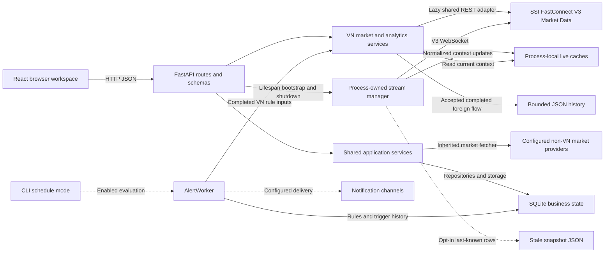

# StockClock Architecture Overview

## 1. System overview

StockClock combines a React workspace, a Python application, local persistence, and external data adapters. The Vietnam workspace uses SSI FastConnect V3 through dedicated services. The same application also hosts inherited analysis, portfolio, backtest, chat, bot, and notification workflows. This overview describes the checked-in architecture at `9fd88009` and uses dated acceptance only where linked. [Product scope](PRD.md) · [Capability and acceptance record](PROJECT_STATE.md)

## 2. High-level architecture

The arrows show request, ownership, or storage dependencies. The web-only launch omits the schedule path. [API application](../api/app.py) · [CLI entrypoint](../main.py) · [Alert worker](../src/services/alert_worker.py)

## 3. Repository structure

| Area | Entrypoint or owner |
| --- | --- |
| Web and desktop | [React bootstrap](../apps/dsa-web/src/main.tsx), [browser routes](../apps/dsa-web/src/App.tsx), [Electron main process](../apps/dsa-desktop/main.js) |
| HTTP and schemas | [ASGI entry](../server.py), [app factory and lifespan](../api/app.py), [v1 route tree](../api/v1/router.py), [endpoint modules](../api/v1/endpoints/), [Pydantic models](../api/v1/schemas/) |
| Business logic | [CLI](../main.py), [orchestration](../src/core/), [application services](../src/services/), [repositories](../src/repositories/), [storage models](../src/storage.py) |
| Data and messaging | [Provider adapters](../data_provider/), [report renderer](../src/services/report_renderer.py), [bot integrations](../bot/), [notification service](../src/notification.py) |
| Operations and verification | [Docker files](../docker/), [scripts](../scripts/), [CI workflows](../.github/workflows/), [backend tests](../tests/), [documentation map](DOCS_INDEX.md) |

## 4. Technology stack

The web workspace uses React 19, TypeScript 5.9, React Router, Vite 7, Tailwind CSS 4, and Axios. VN candles use Lightweight Charts 5.2.0. Analytical views also use Recharts. The backend uses FastAPI/Pydantic on Uvicorn, SQLAlchemy with SQLite by default, and `schedule` for the CLI scheduling path. Docker builds the web bundle with Node 20 and runs the application on Python 3.11. SSI Market Data uses `ssi-sdk==3.0.5`. Electron wraps the local web application in the desktop distribution. [Web manifest](../apps/dsa-web/package.json) · [Python requirements](../requirements.txt) · [Dockerfile](../docker/Dockerfile) · [Desktop manifest](../apps/dsa-desktop/package.json)

## 5. Module responsibilities

| Boundary | Responsibility and evidence |
| --- | --- |
| Browser | Routes, selection, filters, rendering, and request lifecycle. Custom VN watchlist persistence is browser-local. The credentialed HTTP client uses relative API paths by default. [Routes](../apps/dsa-web/src/App.tsx) · [VN dashboard](../apps/dsa-web/src/pages/VietnamDashboardPage.tsx) · [HTTP client](../apps/dsa-web/src/api/index.ts) |
| HTTP | Parse and validate inputs, delegate service work, and serialize typed responses. VN is under `/api/v1/stocks/vn`; alert rules and history use `/api/v1/alerts`. [Router](../api/v1/router.py) · [Stocks endpoints](../api/v1/endpoints/stocks.py) · [Alerts endpoints](../api/v1/endpoints/alerts.py) |
| VN services | Normalize provider rows, establish source/session quality, share cache work, and calculate analytics. [Market data](../src/services/vietnam_market_service.py) · [Company research](../src/services/vietnam_company_research_service.py) · [Completed flow](../src/services/vietnam_foreign_flow_service.py) · [Current flow](../src/services/vietnam_flow_data_service.py) |
| Shared application | Inherited analysis, reports, portfolio, and backtest have their own contracts and market-data path. Shared alert CRUD, evaluation, persistence, and notification infrastructure supports completed VN rule families. [Analysis pipeline](../src/core/pipeline.py) · [Inherited market fetcher](../data_provider/base.py) · [Alert service](../src/services/alert_service.py) · [Portfolio schema](../api/v1/schemas/portfolio.py) · [Backtest service](../src/services/backtest_service.py) |

## 6. Request and data flow

1. A page sends a request through the web API client. The versioned FastAPI route validates the input, delegates to the domain service, and returns the result and quality state for rendering. In development Vite proxies `/api`. In the packaged runtime FastAPI serves the built SPA. [Vite configuration](../apps/dsa-web/vite.config.ts) · [Application](../api/app.py) · [Stocks endpoints](../api/v1/endpoints/stocks.py)
2. Daily watchlist and chart services use validated SSI daily OHLCV. `latest_price` normally uses the accepted DailyOhlc close. When daily history fails freshness and a newer eligible DailyStockPrice close is available, the existing degradation is explicitly partial and suppresses stale-history indicators. Indicators use the corresponding accepted inputs, including Wilder/RMA RSI14. [Market service](../src/services/vietnam_market_service.py) · [Freshness cases](../tests/test_vietnam_daily_history_freshness.py)
3. Breadth resolves exact current SSI VN30 membership and bounded daily histories. Sector analytics reuse breadth and read completed flow separately. Relative performance aligns exact provider sessions, using `indexSummary` points for VNINDEX/VN30 and a current same-ICB peer proxy when available. [Breadth](../src/services/vietnam_market_breadth_service.py) · [Sectors](../src/services/vietnam_sector_strength_service.py) · [Relative strength](../src/services/vietnam_relative_strength_service.py)
4. Foreign Flow reads accepted completed DailyStockPrice history and separately publishes provisional `ForeignRoomMessage` snapshots. Stream messages replace prior symbol/session snapshots. Current aggregates use eligible cached rows and expose coverage. Accepted same-date completed data takes precedence in the display. [Flow services](../src/services/vietnam_flow_data_service.py) · [Current flow contract](VN_DATA_CONTRACT.md#ssi-v3-m26b-current-foreign-flow-contract)

## 7. Market-data provider boundaries

- VN REST routes use the sole V3 provider router. The process shares a lazy V3 adapter for the active settings. DailyOhlc is the public daily candle lineage. Its V3 implementation uses `securitiesSummary`. DailyStockPrice owns accepted completed flow and supported daily summary fields. IndexComponents supplies current membership. [REST router](../data_provider/ssi_provider_router.py) · [V3 adapter](../data_provider/ssi_v3_adapter.py)
- SSI `IntradayOhlc` owns 1m bars, including delayed, sparse current-session data. Streaming quote, order-book, trade, room, and market-index contexts have separate freshness and entitlement gates. Stream trade events cannot fill chart bars or completed prices. [Data contract](VN_DATA_CONTRACT.md) · [Stream adapter](../data_provider/ssi_v3_streaming.py)
- V2, Mozyfin, legacy KBS diagnostics, and injected test data have separate historical or test roles. SSI-owned production fields use SSI or explicit unavailable/stale states. Optional personal/local news has separate configuration and terms gates. [Current SSI contract](SSI_FASTCONNECT_INTEGRATION.md#current-production-contract) · [Decisions](DECISIONS.md)

## 8. Cache and persistence

| Store | Contents and lifetime |
| --- | --- |
| Process memory | VN service histories, membership, benchmark points, live context buffers, and current aggregate state. Cache policy and same-key coalescing depend on the service. A cache hit and a fresh provider session are separate facts. [Market service](../src/services/vietnam_market_service.py) · [Membership cache](../src/services/vietnam_vn30_membership_cache.py) · [Relative strength cache](../src/services/vietnam_relative_strength_service.py) |
| Accepted Foreign Flow history | Bounded, versioned JSON under `DATA_CACHE_DIR` by default. Loads at application startup and uses atomic replacement. Stores accepted completed rows and preserves the latest accepted data against weaker refreshes. [History store](../src/services/vietnam_foreign_flow_history_store.py) · [Restart cases](../tests/test_vietnam_foreign_flow_history_store.py) |
| Optional last-known streaming snapshot | With `SSI_STREAMING_SNAPSHOT_ENABLED`, a separate bounded JSON file can retain normalized context rows, including foreign room. Restored rows are stale. Provisional flow and aggregates stay outside completed history and completed-session alerts. [Snapshot store](../data_provider/ssi_streaming_snapshot_store.py) · [Restore cases](../tests/test_ssi_streaming_snapshot_store.py) |
| SQLite business state | SQLAlchemy models include daily rows, news and analysis history, backtest results, portfolio records, conversations, usage, and alert rules, triggers, notifications, and cooldowns. The manager initializes tables and applies configurable SQLite busy timeout, WAL, and write retries. [Storage models and manager](../src/storage.py) · [Alert repository](../src/repositories/alert_repo.py) |
| Browser and experimental data | The VN custom watchlist is stored per browser. Experimental manual proprietary EOD data uses a separate validated file store with its own source gate. [Custom watchlist](../apps/dsa-web/src/utils/vietnamCustomWatchlist.ts) · [EOD store](../src/services/vietnam_proprietary_flow_eod_store.py) |

## 9. Background jobs and streaming lifecycle

- **FastAPI lifespan** initializes system configuration and restores accepted foreign-flow history before readiness. It schedules stock-index refresh and configured SSI streaming bootstrap in the background. Shutdown cancels outstanding startup tasks and stops the shared streaming lifecycle. [Application lifecycle](../api/app.py)
- **SSI streaming** has one manager per backend process, configured bootstrap scope, and a reconnect monitor. Current-flow routes read shared cache state and may request bounded leases or recovery through the manager. The lifecycle retains connection ownership. [Streaming lifecycle](../src/services/ssi_streaming_realtime_lifecycle.py) · [Flow service](../src/services/vietnam_flow_data_service.py)
- **Scheduled work** runs through the CLI scheduling branch and `src/scheduler.py`. With `AGENT_EVENT_MONITOR_ENABLED`, `AlertWorker` evaluates enabled rules, records outcomes, and dispatches through configured channels. VN evaluators use accepted completed inputs, and the worker deduplicates their same-rule/scope/session triggers. Web-only mode serves the rule API and UI. [CLI](../main.py) · [Scheduler](../src/scheduler.py) · [Worker](../src/services/alert_worker.py) · [VN evaluators](../src/services/vietnam_watchlist_alerts.py)

## 10. Security and configuration

- `Config` and its registry define environment and `.env` settings. SSI REST, streaming, and snapshot persistence have separate gates. Keep provider credentials on the backend and use private runtime configuration. [Configuration loader](../src/config.py) · [Registry](../src/core/config_registry.py) · [Example variable names](../.env.example) · [Secrets policy](SECURITY_AND_SECRETS.md)
- Optional single-admin authentication protects `/api/v1/` when enabled, with explicit route exemptions. The app uses a local password hash and signing secret alongside the database and a signed HttpOnly, SameSite=Lax session cookie. `Secure` follows HTTPS and the configured proxy trust path. CORS defaults to local development origins with configuration for additional origins. [Auth middleware](../api/middlewares/auth.py) · [Auth implementation](../src/auth.py) · [Cookie handling](../api/v1/endpoints/auth.py) · [CORS setup](../api/app.py)

## 11. Deployment architecture

| Mode | Checked-in launch path |
| --- | --- |
| Local Web | Vite plus the local API via the repository launchers, or the built SPA served by the API. `python main.py --serve-only` starts the API/UI. `uvicorn server:app` loads the ASGI application directly. [VN runbook](RUNBOOK_VN.md) · [Backend launcher](../scripts/start_backend_local.ps1) · [ASGI entry](../server.py) |
| Docker and Render-style hosting | The multi-stage image copies `static/` into the Python runtime and runs as non-root `dsa`. The default command is `python main.py --webui-only`, an alias for `--serve-only`. Entrypoint path checks and HTTP health support startup, and `PORT` selects the container listener. Retain writable data, cache, and log paths. [Dockerfile](../docker/Dockerfile) · [Entrypoint](../docker/entrypoint.sh) · [Docker/Render runbook](RUNBOOK_DOCKER_RENDER.md) |
| Electron | The desktop main process starts a local backend process and loads its served web UI. The preload bridge and renderer have their own boundary. [Desktop entry](../apps/dsa-desktop/main.js) · [Preload](../apps/dsa-desktop/preload.js) · [Packaging](desktop-package.md) |

The normal launcher uses one Uvicorn worker. Keep one backend worker for coherent live state. The checked-in Compose environment still includes a legacy Mozyfin variable and omits SSI V3 credential forwarding. Hosted runtime acceptance remains unobserved in the retained VN current-flow run. [Launcher](../main.py) · [Compose](../docker/docker-compose.yml) · [Acceptance record](PROJECT_STATE.md)

## 12. Error handling and observability

FastAPI registers structured HTTP, validation, and unexpected-error handlers. Python logging writes console and rotating file output. Startup stages identify pre-readiness progress. `/api/health` verifies HTTP readiness. VN observability and intraday health report separate provider, cache, and freshness signals. Optional capability failures can leave usable data in other sections, with stale or unavailable states visible. Provider troubleshooting uses sanitized metadata. [Error handlers](../api/middlewares/error_handler.py) · [Logging](../src/logging_config.py) · [Startup tracing](../src/startup_trace.py) · [API catalog](API_CATALOG.md) · [Runbook](RUNBOOK_VN.md)

## 13. Testing architecture

| Layer | Existing checks |
| --- | --- |
| Python | `scripts/ci_gate.sh` runs syntax, flake8, deterministic, and offline stages in CI. `python -m pytest -m "not network"` is the offline test selector. Targeted cases cover source lineage, failure and cache behavior, stream lifecycle, acceptance of completed rows, and alert deduplication. [CI gate](../scripts/ci_gate.sh) · [Lineage tests](../tests/test_vietnam_daily_ohlc_lineage.py) · [Lifecycle tests](../tests/test_vietnam_stream_lifecycle.py) · [Alert tests](../tests/test_vietnam_watchlist_alerts.py) |
| Web | In `apps/dsa-web`, `npm test` runs Vitest with jsdom and `npm run test:smoke` runs the Playwright suite. Web CI installs from lockfile, lints, and builds. [Scripts](../apps/dsa-web/package.json) · [Vitest](../apps/dsa-web/vitest.config.ts) · [Playwright](../apps/dsa-web/playwright.config.ts) · [CI](../.github/workflows/ci.yml) |
| Runtime acceptance | Injected fixtures verify deterministic behavior. Bounded live checks need separate authorization, an eligible session, and explicit provider and deployment evidence. [Test strategy](TEST_STRATEGY.md) · [VN runbook](RUNBOOK_VN.md) · [Review checklist](REVIEW_CHECKLIST.md) |

## 14. Known architectural limitations

- Process-local caches, subscriptions, and recovery state limit multi-worker coherence. The default web container also requires a separate operational decision to run scheduled alerts. Compose credential wiring and hosted acceptance remain open. [Docker/Render runbook](RUNBOOK_DOCKER_RENDER.md)
- Current cohort analytics have historical membership bias. Incomplete provider data, anomaly sessions, delayed intraday, and optional streaming entitlement constrain coverage. Cold benchmark work can require 42 exact-date reads. [SSI integration](SSI_FASTCONNECT_INTEGRATION.md) · [Active roadmap](VN_DASHBOARD_ROADMAP.md)
- Storage has a local entity inventory and per-service cache bounds. A consolidated backup, retention, and migration policy remains a documentation gap. Route diagnostics and logs are available. Operator-level service objectives and incident ownership remain open. [Documentation audit](DOCUMENTATION_AUDIT.md#prioritized-remaining-gaps)

## 15. Extension guidelines

Keep API contracts with routes and schemas, reuse the VN service and provider boundaries, and use the shared alert worker for completed-session rules. Verify source lineage, coverage, finality, missing versus zero, and the failure path before adding a metric. Preserve process ownership of provider connections. Record changes in the appropriate documentation owner and distinguish deterministic evidence from dated runtime acceptance. [Repository rules](../AGENTS.md) · [Data contract](VN_DATA_CONTRACT.md) · [Documentation map](DOCS_INDEX.md)

Future architecture is unassigned. The PRD evaluates product candidates. A selected candidate needs an explicit scope and a design grounded in its data, privacy, operational, and validation requirements before architecture changes are considered. [Product opportunities](PRD.md#11-proposed-opportunities) · [Active roadmap](VN_DASHBOARD_ROADMAP.md#active-roadmap)
